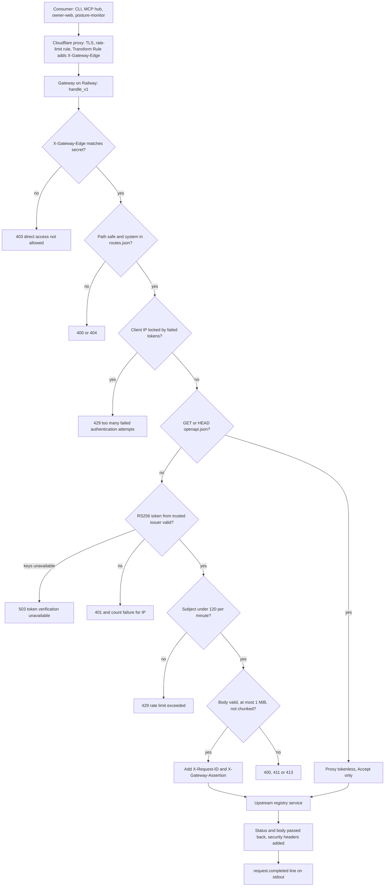
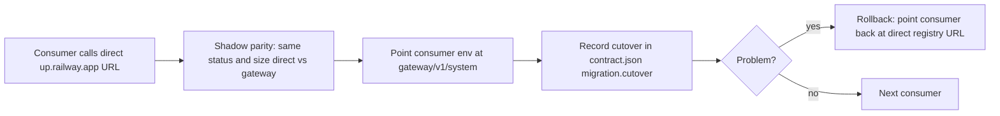
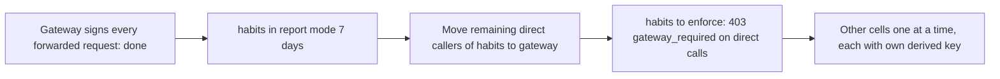

# 01 — Business process (As-Is / To-Be)

repo นี้คือ **edge API gateway** ของ Book Platform: `https://gateway.bookchaowalit.com/v1/<system>/<path>` รับ request จาก consumer แล้ว proxy ไปยัง service ของ registry (Railway) ตาม `routes.json`
"business process" ของ repo นี้จึงเป็นกระบวนการรับ request ของ consumer หนึ่งครั้ง และกระบวนการย้าย consumer (cutover) ทีละราย ไม่ใช่ธุรกรรมของลูกค้า
นอกจากนี้ยังมี pilot เดิม `/api/*` (token เดียว, upstream เดียว) ที่ README บอกว่า unset ใน production

## As-Is (จากโค้ดวันนี้)

Sources: `src/book_api_gateway/edge.py` (`handle_v1`, `_proxy`), `src/book_api_gateway/server.py` (`_dispatch`, `_handle_request`), `API.md` (Edge routes table), `docs/specs/001-edge-gateway.md`

### Consumer cutover (As-Is process, ทีละราย)

Cutovers ที่บันทึกแล้ว (2026-11-03): platform-posture-monitor, owner CLI + local MCP (`client.env`, 10 cells), remote MCP hub `platform-mcp-remote-worker` (29 cells), owner-web บน Vercel (14 cells)

Sources: `contract.json` (`migration.shadow_parity`, `migration.cutover`, `migration.rollback`), `README.md`, ops record: api-gateway-edge (2026-11-03)

## To-Be (จากเอกสารใน repo เท่านั้น)

Sources: `docs/specs/002-gateway-assertion.md` (Rollout), `contract.json` (`migration.cutover` "Next: ..."), `docs/UPGRADE-PLAN.md` (Backlog P0: identity subject assertion, shadow-parity fixtures; P2: rollback-route drill, cache `/readyz`)

## Open questions

- PRODUCT.md มี `[ต้องยืนยัน] The cutover criteria for activating the runtime` — เกณฑ์ cutover อย่างเป็นทางการยังไม่ถูกกำหนด
- consumer ที่ยังเรียก direct (crm-ledger, knowledge) จะย้ายมาหรือคงไว้ถาวร (ทั้งสองใช้ token ที่ไม่ใช่ platform RS256)
- pilot `/api/*` จะถูกลบออกหรือคงไว้ (UPGRADE-PLAN ยังถือ P0 "identity subject assertion" สำหรับ class นี้)
