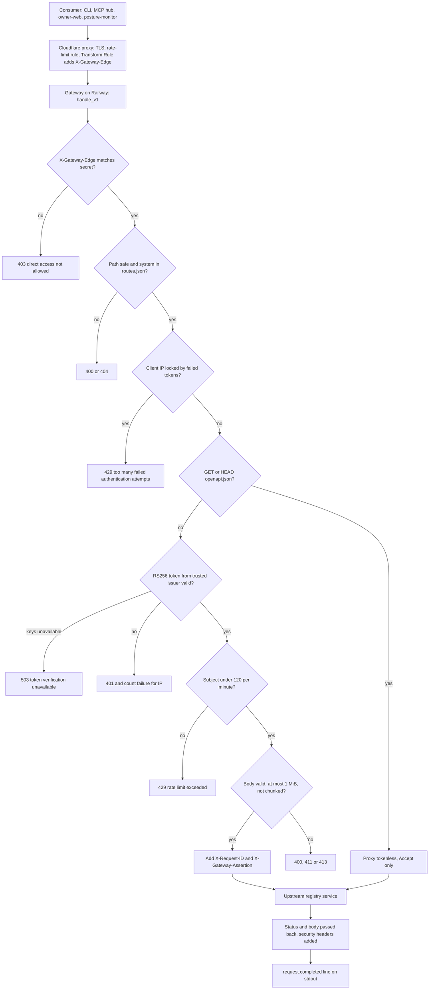
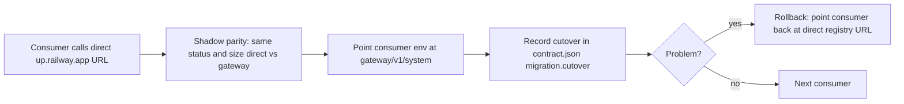
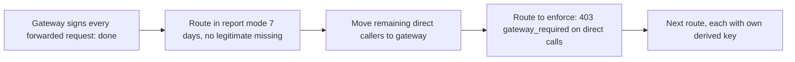

# 01 — Business process (As-Is / To-Be)

repo นี้คือ **edge API gateway** ของ Book Platform: `https://gateway.bookchaowalit.com/v1/<system>/<path>` รับ request จาก consumer แล้ว proxy ไปยัง service ของ registry (Railway) ตาม `routes.json`
"business process" ของ repo นี้จึงเป็นกระบวนการรับ request ของ consumer หนึ่งครั้ง และกระบวนการย้าย consumer (cutover) ทีละราย ไม่ใช่ธุรกรรมของลูกค้า
นอกจากนี้ยังมี pilot เดิม `/api/*` (token เดียว, upstream เดียว) ที่ README บอกว่า unset ใน production

Last reviewed: 2026-11-27 · commit `426cecc`

## As-Is (จากโค้ดวันนี้)

Sources: `src/book_api_gateway/edge.py` (`handle_v1`, `_proxy`), `src/book_api_gateway/server.py` (`_dispatch`, `_handle_request`), `API.md` (Edge routes table), `docs/specs/001-edge-gateway.md`

### Consumer cutover (As-Is process, ทีละราย)

Cutovers ที่บันทึกแล้ว (2026-11-03): platform-posture-monitor, owner CLI + local MCP (`client.env`, 10 cells), remote MCP hub `platform-mcp-remote-worker` (29 cells), owner-web บน Vercel (14 cells)

Sources: `contract.json` (`migration.shadow_parity`, `migration.cutover`, `migration.rollback`), `README.md`, ops record: api-gateway-edge (2026-11-03)

## To-Be (จากเอกสารใน repo เท่านั้น)

`assertion-status.json` วันนี้: 41 routes = enforce 8, report 27, planned 3, exempt 3 (ai-gateway, book-job-data empire-platform); route ที่ยังไม่ enforce คือ To-Be ของ SPEC-002

Sources: `docs/specs/002-gateway-assertion.md` (Rollout, R6), `assertion-status.json`, `contract.json` (`migration.cutover`), `docs/UPGRADE-PLAN.md` (Backlog P0: identity subject assertion, shadow-parity fixtures; P2: rollback-route drill, cache `/readyz`)

## Gap

| ID | As-Is → To-Be | Status | Owner | Evidence |
|---|---|---|---|---|
| G1 | gateway ไม่เซ็นคำขอ → เซ็น `X-Gateway-Assertion` ทุก request ที่ forward | done | claude | `docs/specs/002-gateway-assertion.md`, `contract.json` migration.cutover (2026-11-03) |
| G2 | 27 routes อยู่ report mode, 3 planned → enforce ทีละ route หลังรายงาน 7 วัน | doing | claude | `assertion-status.json` (enforce 8 / report 27 / planned 3 / exempt 3) |
| G3 | pilot `/api/*` ใช้ token เดียว → identity subject assertion (UPGRADE-PLAN P0) | decide | owner | `docs/UPGRADE-PLAN.md` Backlog P0; ยังไม่ตัดสินว่าจะลบ pilot หรือคงไว้ |
| G4 | ไม่มี shadow-parity fixtures ใน repo → fixtures ที่ replay ได้ | todo | claude | `docs/UPGRADE-PLAN.md` Backlog P0 |
| G5 | `/readyz` probe ทุกครั้ง → cache 1–2 วินาที, และเอกสาร rollback-route drill | todo | claude | `docs/UPGRADE-PLAN.md` Backlog P2 |
| G6 | consumer ที่เรียก direct (crm-ledger, knowledge) → ผ่าน gateway | decide | owner | `contract.json` migration.cutover (ทั้งสองไม่ใช่ platform RS256 token); ไม่มี To-Be ที่เขียนไว้ |

## Open questions

- PRODUCT.md มี `[ต้องยืนยัน] The cutover criteria for activating the runtime` — เกณฑ์ cutover อย่างเป็นทางการยังไม่ถูกกำหนด
- consumer ที่ยังเรียก direct และ pilot `/api/*` ดู G6 และ G3
- ตัวเลข routes ใน `assertion-status.json` เปลี่ยนบ่อย ให้ดูไฟล์นั้นเป็นหลัก
