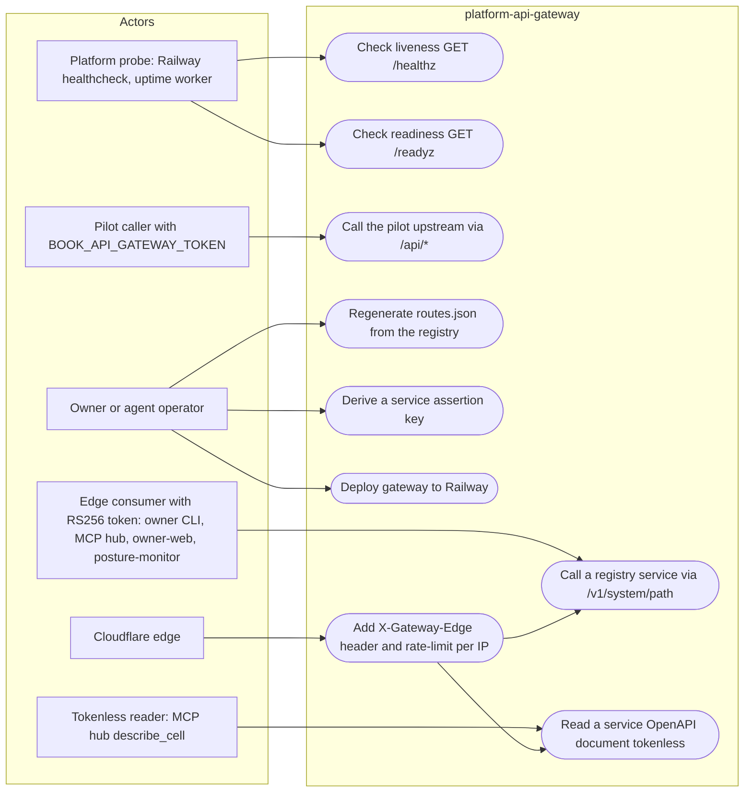

# 02 — Use cases

Actors คือ caller จริงตาม route access classes ใน `ROUTE_ACCESS` (`server.py`): public probe, edge caller ที่มี platform RS256 token, caller tokenless ของ `openapi.json`, pilot service token และ operator ที่ดูแล route table / key

| Use case | Auth level | Methods | Source |
|---|---|---|---|
| `/healthz`, `/readyz` | public | GET | `server.py` `ROUTE_ACCESS` |
| `/v1/<system>/*` | platform-token (edge header + RS256) | GET, HEAD, POST, PUT, PATCH, DELETE | `edge.py` `METHODS`, `handle_v1` |
| `/v1/<system>/openapi.json` | public (แต่ยังต้องผ่าน edge lock) | GET, HEAD | `edge.py` `PUBLIC_OPENAPI` |
| `/api/*` | service token | GET, POST | `server.py` `_authenticate` |
| regenerate routes | local operator | — | `scripts/generate_routes.py` |
| derive assertion key | local operator, master key in env | — | `scripts/assertion_key.py` |

Sources: `src/book_api_gateway/server.py`, `src/book_api_gateway/edge.py`, `scripts/generate_routes.py`, `scripts/assertion_key.py`, `API.md`, `contract.json` (`migration.cutover`), `.railway/railway.ts`

## Open questions

- ไม่มี role/scope ภายใน gateway: audience และ scope เป็นการตัดสินใจของแต่ละ service (SPEC-001 R3) — ถ้าต้องการ allow-list ต่อ consumer ที่ gateway ต้องมี spec ใหม่
