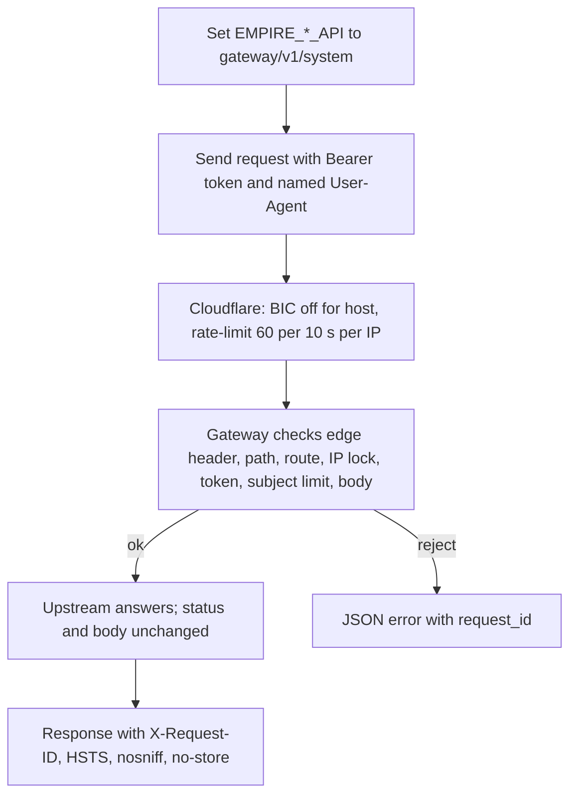
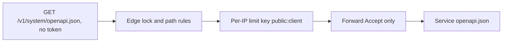
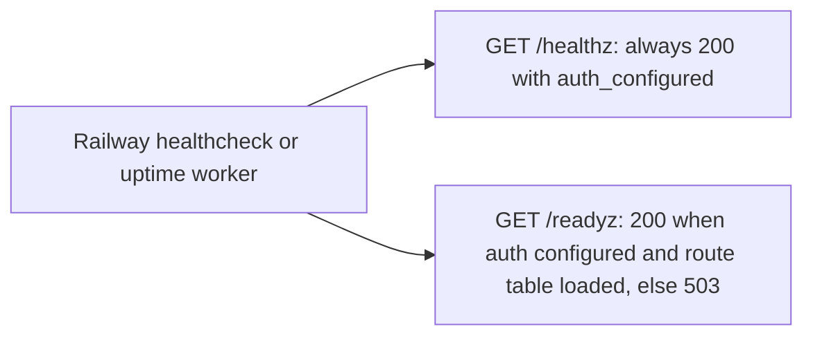
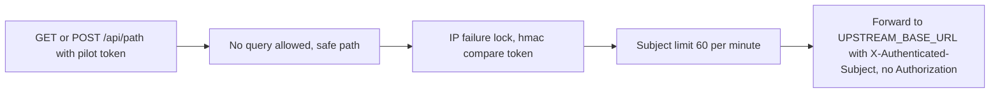

# 03 — User flows (per caller)

ไม่มี UI; "user flow" คือเส้นทางของ caller แต่ละประเภทผ่าน route classes

## Edge consumer (RS256 token)

## Tokenless OpenAPI reader (describe_cell)

## Platform probe

## Pilot caller (`/api/*`, unset in production)

Sources: `src/book_api_gateway/edge.py`, `src/book_api_gateway/server.py` (`_dispatch` readiness branch, `_proxy`), `src/book_api_gateway/config.py` (pilot defaults), `API.md`, ops record: api-gateway-edge (2026-11-03) (Cloudflare BIC rule, named User-Agent)

## Open questions

- ไม่มี flow สำหรับ caller ที่ต้องการ WebSocket หรือ streaming (SPEC-001 Out of scope)
