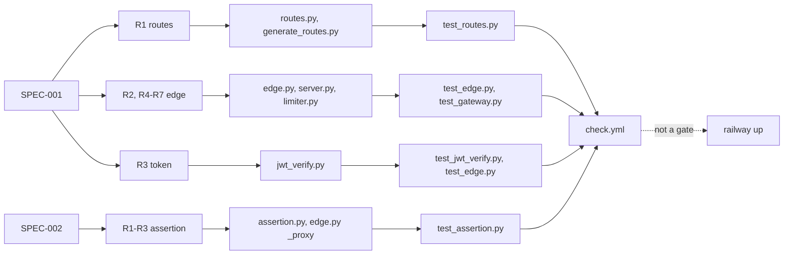

# 04 — Traceability (RTM)

Requirement จาก `docs/specs/001-edge-gateway.md` (SPEC-001) และ `docs/specs/002-gateway-assertion.md` (SPEC-002) ↔ code ↔ test ↔ release
Release ของทุกแถวเหมือนกัน: CI `.github/workflows/check.yml` (job `contract`, `security`) บน push แล้ว deploy ด้วย Railway CLI (`railway up`, ไม่ผูกกับ CI — ดู [18](18-git-release-workflow.md))

| Req | Requirement (สั้น) | Code | Test |
|---|---|---|---|
| 001-R1 / AC7 | route table จาก registry, https only | `src/book_api_gateway/routes.py` `load_routes`; `scripts/generate_routes.py` | `tests/test_routes.py` `test_only_online_https_services`, `test_committed_table_is_valid`, `test_rejects_unsafe_entries` |
| 001-R2 / AC3 | edge lock `X-Gateway-Edge` | `edge.py` `handle_v1` (hmac.compare_digest) | `test_edge.py` `test_ac3_direct_access_is_refused`, `test_ac5_client_ip_comes_from_cloudflare_only_with_the_edge_secret` |
| 001-R3 / AC2 | RS256, trusted iss, exp/nbf/iat, sub/aud, JWKS cache | `jwt_verify.py` `TokenVerifier`, `IssuerKeys` | `test_jwt_verify.py` (all), `test_edge.py` `test_ac2_bad_tokens_never_reach_upstream` |
| 001-R3a | tokenless `openapi.json` | `edge.py` `PUBLIC_OPENAPI` | `test_edge.py` `test_openapi_is_the_only_tokenless_path` |
| 001-R4 / AC5 | failure limit per IP, subject limit | `edge.py`, `limiter.py` | `test_edge.py` `test_ac5_failed_tokens_lock_the_ip`, `test_ac5_subject_limit`; `test_gateway.py` `LimiterBoundTests` |
| 001-R4 / AC4 | path rules, unknown system | `edge.py` `unsafe_path`, `routes.match` | `test_edge.py` `test_ac4_unknown_system_and_unsafe_paths`; `test_routes.py` `Match` |
| 001-R5 / AC1 | faithful proxy, forwarded headers, Location rewrite, 502/504 | `edge.py` `_proxy`, `_rewrite_location` | `test_edge.py` `test_ac1_*`, `test_location_is_rewritten_to_the_gateway_path`, `test_not_modified_passes_through`, `test_protocol_and_reset_errors_are_502_not_500_or_504`, `test_truncated_upstream_answer_is_502`, `test_head_keeps_the_upstream_length`; `test_routes.py` `Redirects`; `test_webhook_provider_map.py` `test_edge_forwarded_headers_match_source` |
| 001-R6 / AC6 | security headers | `server.py` `_send_bytes` | `test_edge.py` `test_ac6_security_headers_everywhere` |
| 001-R7 | redacted telemetry | `server.py` `_handle_request`, `_default_telemetry` | `test_edge.py` `test_telemetry_never_carries_token_or_path_tail`; `test_gateway.py` `test_telemetry_is_redacted` |
| 001-R8 | standard library only | `Dockerfile` (no install step), `check.yml` `install-command: "true"` | — (no test; enforced by absence of dependency files) |
| 002-R1 | per-service derived key | `assertion.py` `system_key`; `scripts/assertion_key.py` | `test_assertion.py` `test_ac1_valid_and_bound_to_the_system_key`, `test_master_key_parsing`, `test_bad_master_key_stops_the_gateway` |
| 002-R2 / AC2 | signed fields, 60 s window | `assertion.py` `_signed_text`, `verify` | `test_assertion.py` `test_ac2_*`, `test_pinned_vectors`, `test_request_id_with_dots_and_colons` |
| 002-R3 / AC3, AC5 | gateway signs, caller value dropped | `edge.py` `_proxy` | `test_assertion.py` `SignedEdge`; `test_edge.py` `test_spec002_assertion_only_with_a_master_key` |
| 002-R4..R7 | service check, report/enforce, rollback | ไม่อยู่ใน repo นี้ (cells copy `verify`; pilot life-habits-api) | test vectors pinned ใน `test_assertion.py` ต้องตรงกับ habits `test_gateway_assertion.py` |
| Contract | contract valid, schema pin, README/API agree | `scripts/check.py`, `scripts/check_schema_pin.py` | `test_contract_check.py`, `test_drift_checks.py` |
| BOO-147 gate | webhook provider map | `fixtures/gates/*.json` | `test_webhook_provider_map.py` |
| Pilot `/api/*` | ROUTE_ACCESS matrix, hardening | `server.py` | `test_route_access.py`, `test_gateway.py` |

Sources: `docs/specs/001-edge-gateway.md`, `docs/specs/002-gateway-assertion.md`, `src/book_api_gateway/*.py`, `tests/*.py`, `.github/workflows/check.yml`, `docs/gates/BOO-147-webhook-provider-map.md`, ops record: api-gateway-edge (2026-11-03)

## Open questions

- R8 (dependency-free) ไม่มี test ที่บังคับ — ต้องการ test ที่ fail เมื่อมี import นอก stdlib หรือไม่
- 002-R6 (switch to enforce หลัง 7 วัน) ไม่มี automated check ที่ฝั่ง gateway
