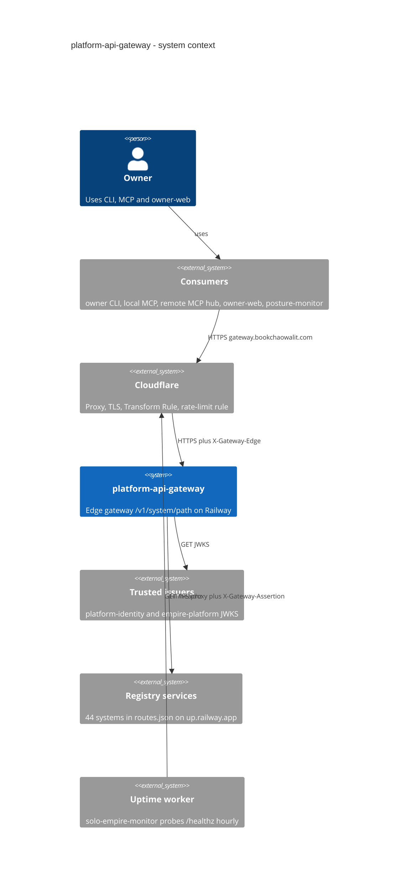

# 05 — C4 Context

หมายเหตุ: `routes.json` มี **44** systems ณ `origin/main` `4c81817` (ops record บันทึก 43 ก่อนเพิ่ม `platform-payment` ใน `51c4711`)

Sources: `routes.json`, `API.md`, `docs/specs/001-edge-gateway.md`, `contract.json` (`depends_on`, `migration.cutover`), `src/book_api_gateway/jwt_verify.py`, platform-uptime-worker `src/targets.ts` (line 85), ops record: api-gateway-edge (2026-11-03)

## Open questions

- trusted issuer URLs จริงอยู่ใน Railway variable `GATEWAY_TRUSTED_ISSUERS` (ไม่อยู่ใน repo) — diagram อ้างตาม SPEC/ops record
