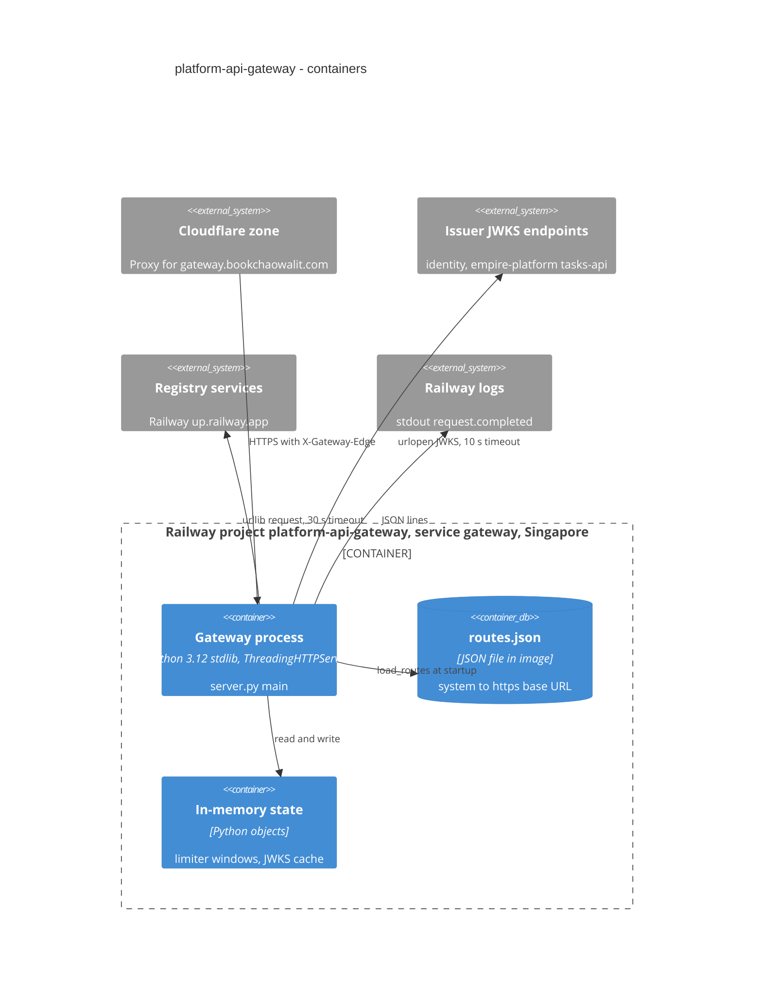

# 06 — C4 Container

Sources: `Dockerfile`, `.railway/railway.ts`, `src/book_api_gateway/server.py` (`main`, `GatewayState`, `_default_telemetry`), `src/book_api_gateway/routes.py`, `src/book_api_gateway/limiter.py`, `src/book_api_gateway/jwt_verify.py` (`_default_fetch`), `src/book_api_gateway/edge.py`, ops record: api-gateway-edge (2026-11-03)

## Open questions

- จำนวน replica ของ service `gateway` — in-memory limiter เป็นต่อ process; ถ้ามีหลาย replica limit จริงจะคูณตามจำนวน (ไม่พบใน config)
