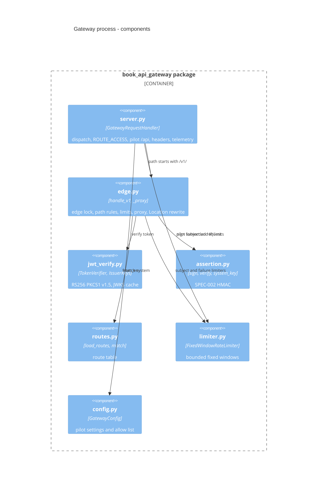

# 07 — C4 Component

Scripts (ไม่อยู่ใน runtime image): `scripts/generate_routes.py`, `scripts/assertion_key.py`, `scripts/check.py`, `scripts/check_schema_pin.py`, `scripts/check_registry_alignment.py`, `scripts/check.sh`

Sources: `src/book_api_gateway/*.py`, `scripts/*.py`, `Dockerfile` (`COPY src`, `COPY routes.json` only)
