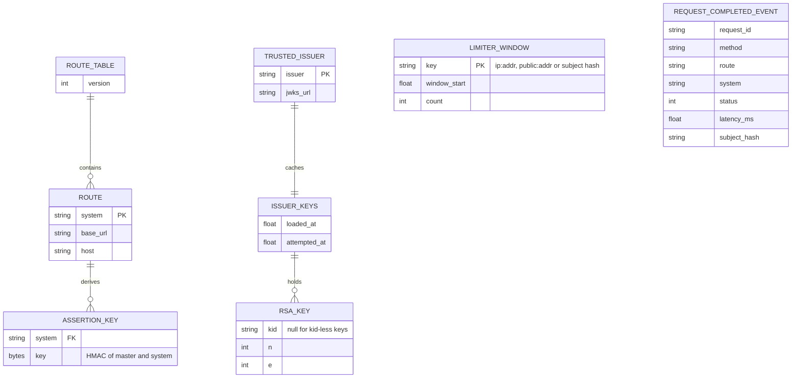

# 09 — ERD (configuration and in-memory data)

gateway **ไม่มี database** (`contract.json` `data_owner: "none"`; PRODUCT.md: "No ... database writer") — สิ่งที่ "persist" คือไฟล์ config ใน image และ state ใน memory ของ process (หายเมื่อ restart)
ภาพนี้จึงเป็น data model ของ config + in-memory structures ไม่ใช่ schema ของ DB

| Entity | Where it lives | Source |
|---|---|---|
| ROUTE_TABLE / ROUTE | `routes.json` (committed, copied into image) | `routes.py`, `routes.json` |
| TRUSTED_ISSUER | env `GATEWAY_TRUSTED_ISSUERS` (Railway variable) | `edge.py` `EdgeSettings.from_env` |
| ISSUER_KEYS / RSA_KEY | memory, TTL 600 s | `jwt_verify.py` `IssuerKeys` |
| LIMITER_WINDOW | memory, ≤ 10,000 keys per limiter | `limiter.py` |
| ASSERTION_KEY | computed per request, never stored | `assertion.py` `system_key` |
| REQUEST_COMPLETED_EVENT | stdout → Railway logs | `server.py` `_handle_request` |

Sources: `routes.json`, `contract.json`, `PRODUCT.md`, `src/book_api_gateway/routes.py`, `jwt_verify.py`, `limiter.py`, `assertion.py`, `edge.py`, `server.py`

Fixture data ของ gate (`fixtures/gates/webhook-provider-map.json`, 34 providers) เป็น evidence ไม่ใช่ runtime data — ดู [`docs/gates/BOO-147-webhook-provider-map.md`](../gates/BOO-147-webhook-provider-map.md) (reused)
