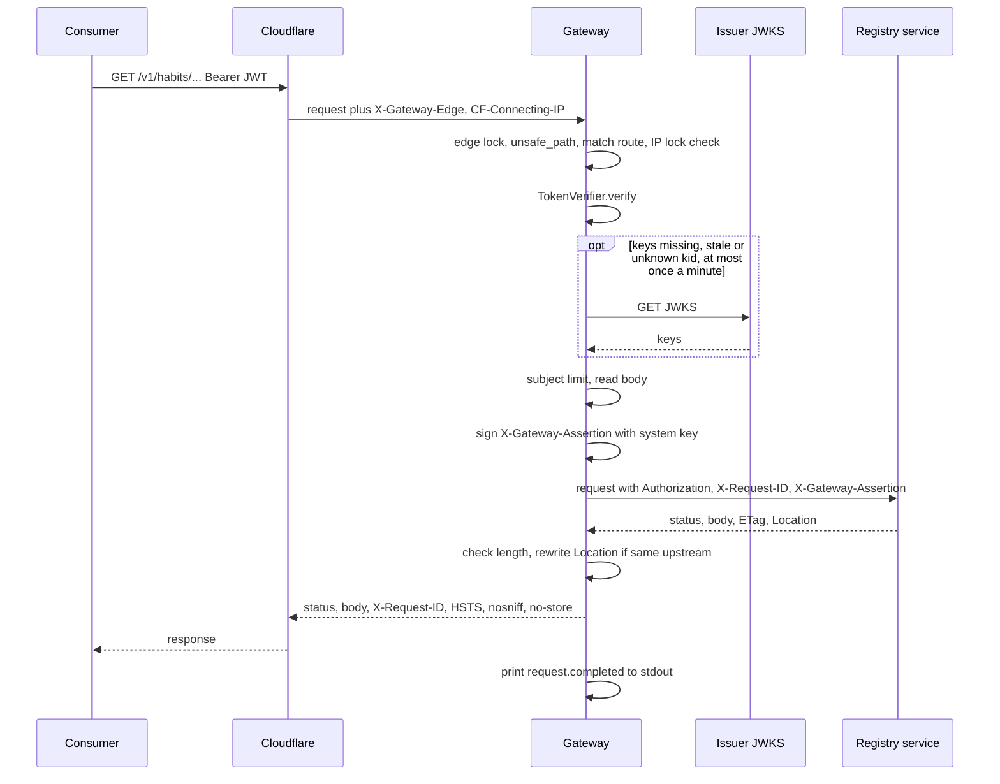
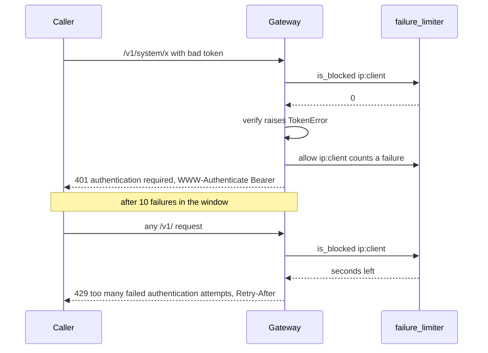
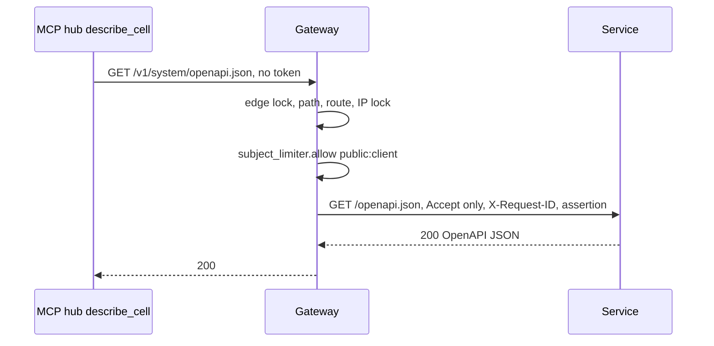
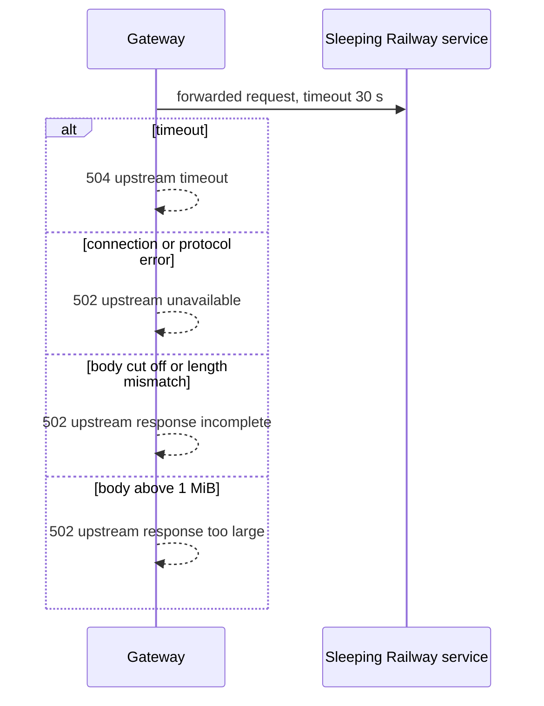

# 10 — Sequences

## 1. Authenticated edge call (happy path)

## 2. Rejected token and IP lock

## 3. Tokenless OpenAPI read (describe_cell)

## 4. Upstream failure

Sources: `src/book_api_gateway/edge.py` (`handle_v1`, `_proxy`), `src/book_api_gateway/jwt_verify.py`, `src/book_api_gateway/assertion.py`, `src/book_api_gateway/server.py`, `docs/specs/001-edge-gateway.md`, `tests/test_edge.py`
