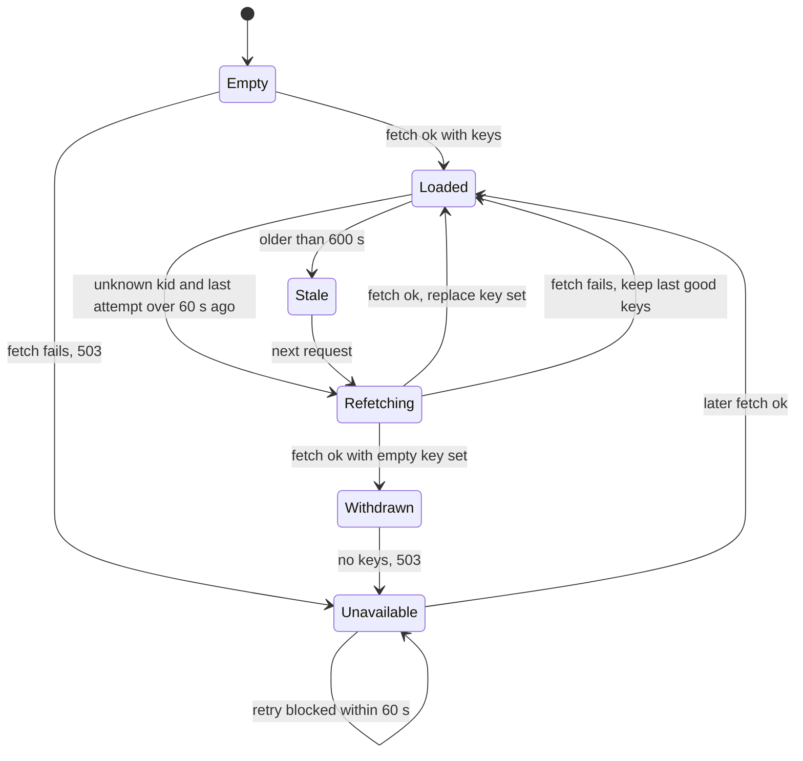
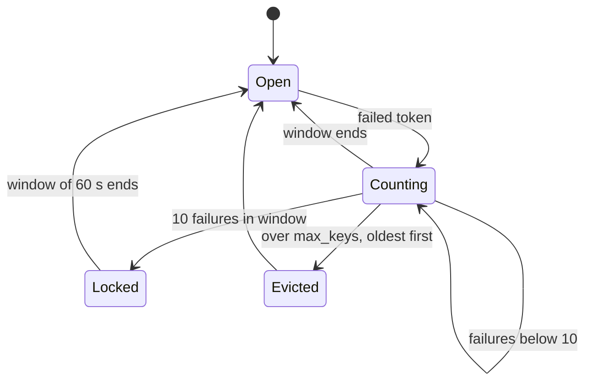
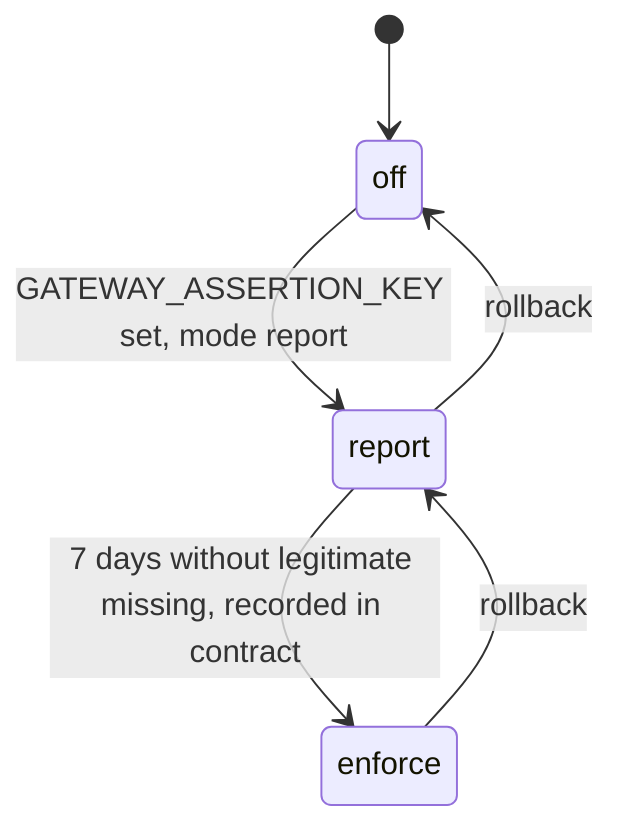
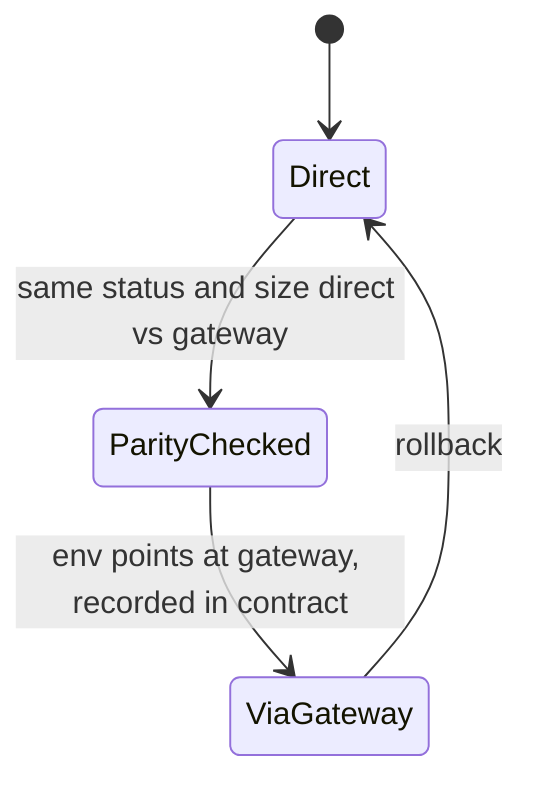

# 11 — State machines

ไม่มี entity ที่มี field `status` ใน DB (ไม่มี DB); lifecycle ที่มีจริงในโค้ดคือ JWKS cache, limiter window ต่อ key และ assertion mode ของ service (กำหนดใน SPEC-002, implement ฝั่ง service)

## JWKS cache per issuer (`IssuerKeys`)

## Failure limiter window per client IP

## Service assertion mode (SPEC-002 R4, R6, R7)

## Consumer cutover

Sources: `src/book_api_gateway/jwt_verify.py` (`_due`, `_load`), `src/book_api_gateway/limiter.py`, `src/book_api_gateway/edge.py`, `docs/specs/002-gateway-assertion.md`, `contract.json` (`migration`)
