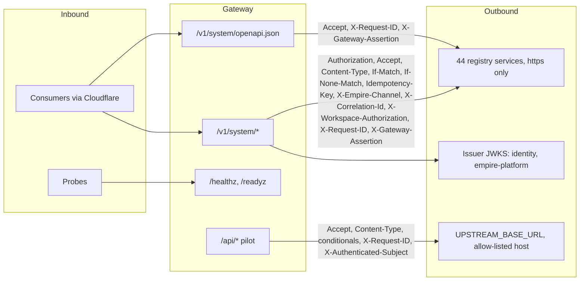

# 12 — API and integrations

**Reused:** endpoint inventory, error table และ env vars ครบอยู่ใน [`API.md`](../../API.md) และ `contract.json` `interfaces` — ไฟล์นี้สรุปเป็นภาพและลิงก์ ไม่ copy

| Interface id | Endpoint | Auth |
|---|---|---|
| `api-gateway.http.healthz` | `GET /healthz` | public |
| `api-gateway.http.readyz` | `GET /readyz` | public |
| `api-gateway.http.proxy` | `GET`/`POST /api/*` (pilot) | pilot bearer token |
| `api-gateway.http.edge` | `GET HEAD POST PUT PATCH DELETE /v1/<system>/*` | `X-Gateway-Edge` + RS256 |
| `api-gateway.http.upstream` | consumes `UPSTREAM_BASE_URL` (pilot) | — |
| `api-gateway.consumes.identity` | consumes trusted issuers' JWKS | — |
| `api-gateway.event.request-completed` | stdout event | — |

Response headers ที่ส่งกลับจาก upstream: `Content-Type`, `ETag`, `Retry-After`, `WWW-Authenticate`, `Location` (เฉพาะ same upstream, rewrite เป็น `/v1/<system>/…`)

Webhooks: gateway **ไม่มี** webhook หรือ provider route (BOO-147 gate บันทึกว่า signature verifier ไม่มีใน gateway และ header signature/idempotency ถูก drop ใน pilot) — reused: [`docs/gates/BOO-147-webhook-provider-map.md`](../gates/BOO-147-webhook-provider-map.md)

Sources: `API.md`, `contract.json`, `src/book_api_gateway/edge.py` (`FORWARD_REQUEST`, `FORWARD_RESPONSE`, `_rewrite_location`), `src/book_api_gateway/server.py` (`FORWARD_HEADERS`, `_proxy`), `routes.json`, `docs/gates/BOO-147-webhook-provider-map.md`, `tests/test_webhook_provider_map.py`
