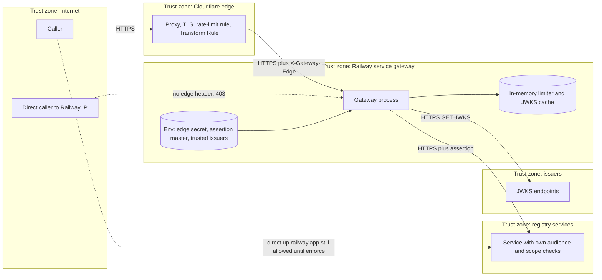

# 13 — Threat model (DFD + STRIDE)

| Element | STRIDE | Threat | Mitigation in code | Gap |
|---|---|---|---|---|
| Caller → Cloudflare | S | forged token | RS256 verify, trusted `iss` only, `alg` must be RS256 (`jwt_verify.py`) | — |
| Caller → Gateway direct | S, E | bypass Cloudflare WAF/limits | `X-Gateway-Edge` constant-time compare → 403 (`edge.py`) | secret ความยาว ≥ 32 เท่านั้น; ไม่มี rotation ใน repo |
| Caller → Service direct | E | bypass gateway entirely | SPEC-002 assertion; habits ใน `report` | ทุก cell ยังรับ direct จนกว่าจะ `enforce` |
| Gateway path handling | T | path traversal / encoded slash | `unsafe_path` → 400 | — |
| Request body | T, D | smuggling, chunked, oversize | 411 chunked, CL must be decimal and single, 1 MiB cap, `Connection: close` when body unread | — |
| Token flood | D | junk tokens drain services | failure limiter per IP (10/min), subject limiter (120/min), Cloudflare 60/10 s | limiter in-memory ต่อ process; reset on restart |
| JWKS endpoint | D, S | issuer down / key withdrawal | 503 fail closed, refetch ≤ 1/min, empty key set withdraws trust | ไม่มี pinning ของ JWKS host นอกจาก https |
| Upstream response | T, I | redirect off-route, oversize, truncated | redirects disabled (`_NoRedirectHandler`), Location same-origin only, length check → 502 | — |
| Assertion | S, R | replay | 60 s window, binds method/target/rid/auth/content-type/body | ไม่มี replay cache (accepted in SPEC-002) |
| Assertion master key | I, E | leak forges all systems | per-system derived keys at services; master only in gateway env / Infisical | ไม่มี rotation procedure ใน repo |
| Telemetry | I | token/PII in logs | only hashed subject, no path tail/query/body; default access log disabled | — |
| Response headers | I | missing HSTS/nosniff (NET-07) | HSTS, nosniff, no-store on every response | ไม่มี CSP (API JSON) |
| Server banner | I | version disclosure | `Server: book-api-gateway` | — |
| Repudiation | R | who called | `X-Request-ID`, subject hash in telemetry | logs เก็บใน Railway เท่านั้น ไม่มี retention ระบุ |

Sources: `src/book_api_gateway/edge.py`, `jwt_verify.py`, `server.py`, `assertion.py`, `limiter.py`, `docs/specs/001-edge-gateway.md`, `docs/specs/002-gateway-assertion.md`, `API.md`, architecture-docs [`systems/architecture/network-architecture.md`](https://github.com/bookchaowalit/architecture-docs/blob/main/systems/architecture/network-architecture.md) (NET-04, NET-07), ops record: api-gateway-edge (2026-11-03)

## Open questions

- Cloudflare Free Managed Ruleset เปิดอยู่หรือไม่ (network-architecture.md NET-04 ระบุ **[ต้องยืนยัน]**)
- ขั้นตอน rotate `GATEWAY_EDGE_SECRET` และ `GATEWAY_ASSERTION_MASTER_KEY` ยังไม่มีเอกสาร
- จำนวน replica (ผลต่อ in-memory limits)
