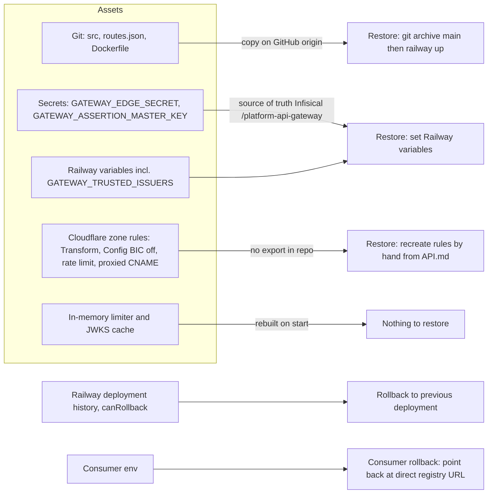

# 14 — Backup and DR

gateway ไม่มีข้อมูลธุรกิจ (`data_owner: none`); สิ่งที่ต้องกู้คืนได้คือ code + route table, secrets และ config ของ Cloudflare/Railway

| Item | Reality |
|---|---|
| Backup workflow | ไม่มี (ไม่จำเป็นสำหรับ DB) — repo มีแค่ `.github/workflows/check.yml` |
| Rollback ของ gateway | Railway deployments มี `canRollback: true` (14 deployments, 2026-11-03, Railway API) |
| Rollback ของ consumer | `contract.json` `migration.rollback`: point the consumer back at the direct registry URL |
| Secrets | Infisical `/platform-api-gateway` + Railway variable (ops record) |
| Cloudflare config | อธิบายใน `API.md` แต่ไม่มี IaC/export |
| RTO / RPO | **not defined** (ไม่มีใน PRODUCT.md, SPEC หรือ UPGRADE-PLAN); RPO ไม่เกี่ยวเพราะไม่มีข้อมูล |
| DR drill | UPGRADE-PLAN P2 "Rollback-route drill documentation" ยังเปิด |

Sources: `contract.json`, `.railway/railway.ts`, `Dockerfile`, `API.md`, `docs/UPGRADE-PLAN.md`, `.github/workflows/check.yml`, Railway `list-deployments` project `platform-api-gateway` (2026-11-03), ops record: api-gateway-edge (2026-11-03)

## Open questions

- RTO ของ gateway — เมื่อ gateway ล่ม consumer ทั้ง 4 กลุ่มล่มพร้อมกัน; ต้องการ fallback อัตโนมัติไป direct URL หรือไม่
- Cloudflare rules ควรถูก export/เก็บเป็น code ที่ไหน
