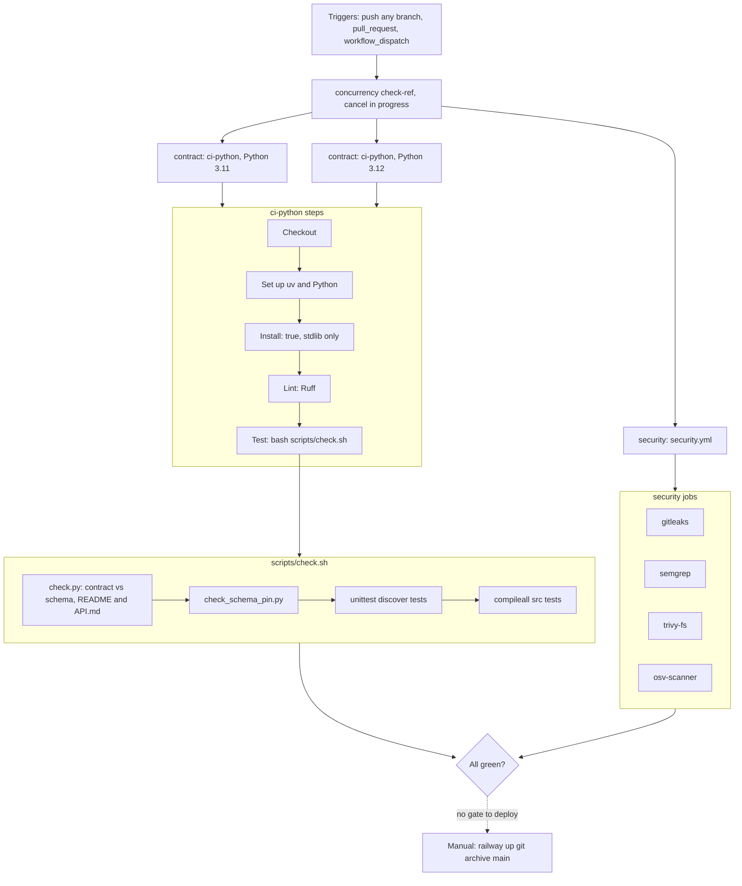

# 15 — CI/CD pipeline

workflow เดียว: `.github/workflows/check.yml` (`Check`) เรียก reusable workflows ของ `bookchaowalit/platform-ci-workflows` pin SHA `87dc5e1c` (v1.1.1) บน GitHub-hosted runners (public repo)
**ไม่มี CD job**: deploy เป็น Railway CLI upload ด้วยมือ (`railway up`, ดู [16](16-deployment.md))

ตัวเลือกที่ปิดไว้ใน caller: `format-check: false` (follow-up ruff format), `typecheck-command: ""` (follow-up mypy)

สถานะจริง ณ 2026-11-03 16:28 UTC: 4 run ล่าสุดบน `main` **failure** ที่ขั้น Ruff — `scripts/assertion_key.py`: `EXE001 Shebang is present but file is not executable`, `RUF100 Unused noqa directive` (2 บรรทัด) ส่วน security jobs ผ่าน

Sources: `.github/workflows/check.yml`, `scripts/check.sh`, platform-ci-workflows `.github/workflows/ci-python.yml` @ `87dc5e1c` (step names), `gh run list -R bookchaowalit-backend/platform-api-gateway`, `gh run view --log-failed` (latest main run)

## Open questions

- ต้องการให้ deploy รอ CI green หรือไม่ (ตอนนี้ deploy `e2bd3ba7` 16:21 UTC เกิดหลัง run แดงของ `e653535`/`8481507`)
