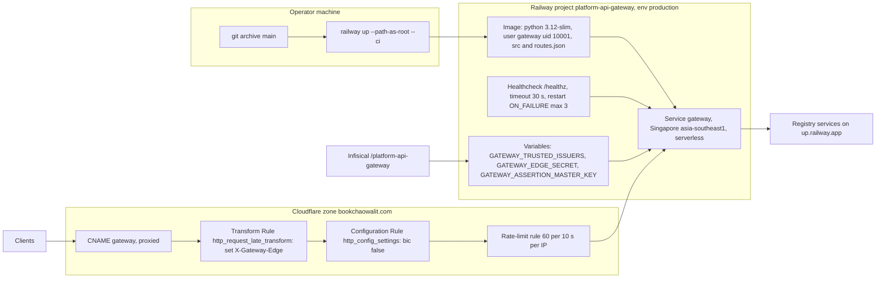

# 16 — Deployment

| Fact | Value | Source |
|---|---|---|
| Host | `https://gateway.bookchaowalit.com` | `README.md`, `API.md` |
| Builder | Dockerfile | `railway.toml` |
| Start command | `python -c "from book_api_gateway.server import main; ..."`, bind `0.0.0.0`, port from `PORT` | `Dockerfile`, `server.py` `main` |
| Region | `asia-southeast1-eqsg3a` | Railway `list-deployments` (2026-11-03) |
| Railway domain | none (`*.up.railway.app` → 404) | ops record: api-gateway-edge (2026-11-03) |
| Deployments | 14, all on 2026-11-03, latest `e2bd3ba7` SUCCESS 16:21 UTC | Railway `list-deployments` |
| Pilot `/api/*` | unset in production | `README.md` |

Sources: `railway.toml`, `Dockerfile`, `README.md`, `API.md`, `src/book_api_gateway/server.py`, `src/book_api_gateway/edge.py` (`from_env`), Railway `list-deployments` project `platform-api-gateway`, ops record: api-gateway-edge (2026-11-03)

## Open questions

- deployment แต่ละครั้งตรงกับ commit ไหน — Railway upload ไม่บันทึก SHA (การจับคู่ใน [22](22-dora.md) ใช้เวลาเป็นหลัก)
