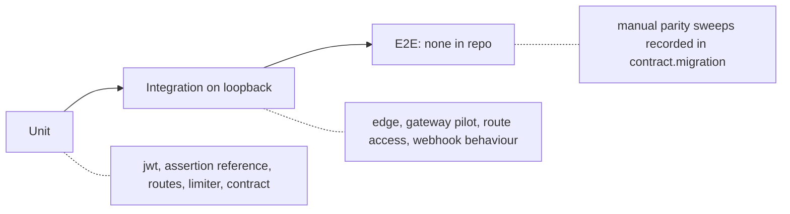

# 17 — Test coverage matrix

ทุก test เป็น `unittest`; "integration" = เปิด gateway จริงบน loopback กับ upstream fixture (`ThreadingHTTPServer`); ไม่มี e2e ผ่าน Cloudflare/Railway ใน repo; ไม่มี coverage gate

| Feature | Unit | Integration (loopback servers) | E2E |
|---|---|---|---|
| RS256 / JWKS cache | `test_jwt_verify.py` (13 tests) | `test_edge.py` `test_ac2_*` | gap |
| Edge lock | — | `test_edge.py` `test_ac3_*`, `test_ac5_client_ip_*` | gap (ops record: manual check direct IP → 403) |
| Path rules / route match | `test_routes.py` `Match`, `Load` | `test_edge.py` `test_ac4_*` | gap |
| Route generation | `test_routes.py` `Generate` | — | — |
| Limits | `test_gateway.py` `LimiterBoundTests` | `test_edge.py` `test_ac5_*`; `test_gateway.py` `test_rate_limit_*`, `test_repeated_bad_tokens_*` | gap |
| Faithful proxy, Location, 502/504, HEAD | `test_routes.py` `Redirects` | `test_edge.py` `test_ac1_*`, `test_location_*`, `test_not_modified_*`, `test_protocol_*`, `test_truncated_*`, `test_head_*`, `test_largest_accepted_token_*` | gap (ops record: manual parity sweeps) |
| Tokenless openapi.json | — | `test_edge.py` `test_openapi_is_the_only_tokenless_path` | gap |
| Security headers | — | `test_edge.py` `test_ac6_*`; `test_gateway.py` `test_server_header_*` | gap |
| Telemetry redaction | — | `test_edge.py` `test_telemetry_*`; `test_gateway.py` `test_telemetry_is_redacted` | — |
| SPEC-002 assertion | `test_assertion.py` `Reference` (9) | `test_assertion.py` `SignedEdge` (3); `test_edge.py` `test_spec002_*` | gap (service side in life-habits-api) |
| Pilot `/api/*` hardening | `test_gateway.py` config tests | `test_gateway.py` `GatewayTests`; `test_route_access.py` | — |
| Contract / schema pin / registry drift | `test_contract_check.py`, `test_drift_checks.py` | — | — |
| BOO-147 webhook map | `test_webhook_provider_map.py` (fixture tests) | `GatewayWebhookBehaviourTests` | — |
| `scripts/assertion_key.py` | gap | — | — |
| `/readyz` with edge configured | gap (only pilot probe tested) | `test_gateway.py` `test_readyz_*` (pilot mode) | — |

Sources: `tests/*.py` (test names from `grep "def test_"`), `scripts/check.sh`, `.github/workflows/check.yml`, `contract.json` (`migration.shadow_parity`)

## Open questions

- ต้องการ smoke test หลัง deploy (เช่น `GET /healthz` + direct-IP 403) เป็น workflow หรือไม่
