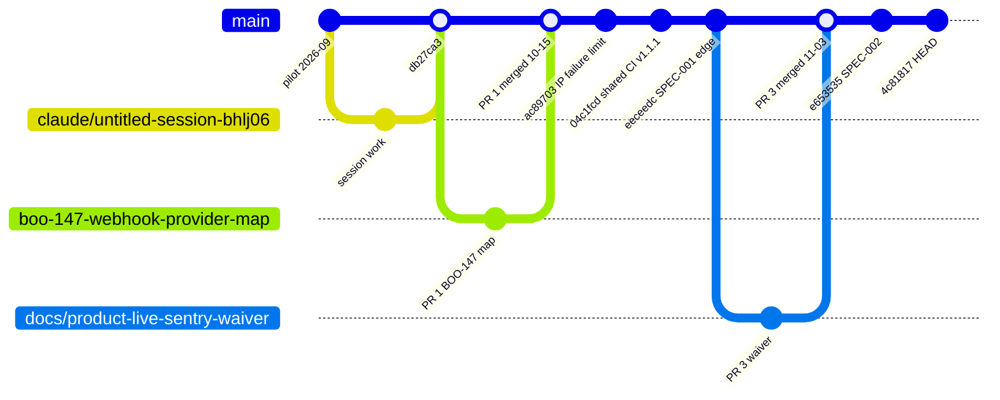
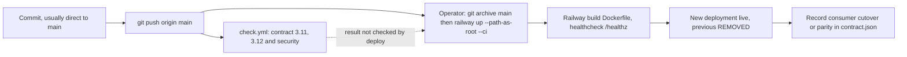

# 18 — Git and release workflow

จาก history จริง: เกือบทุก commit push ตรงเข้า `main` (48 commits ใน 90 วัน มี merge commit เดียว `db27ca3`); PR มี 3 รายการ (#1, #2 BOO-147; #3 `docs/product-live-sentry-waiver`) merged แบบไม่มี merge commit
Release = Railway CLI upload ของ `git archive main` ทำโดย operator; ไม่มี tag หรือ release notes

หมายเหตุ: gitGraph ด้านบนย่อเฉพาะจุดสำคัญ (ไม่ใช่ทุก commit); ลำดับ PR #2 (`boo-147-owner-decision`, merged 2026-10-16) ไม่ได้แสดง

Sources: `git log origin/main`, `git branch -r`, `gh pr list -R bookchaowalit-backend/platform-api-gateway --state all`, `.github/workflows/check.yml`, `.railway/railway.ts`, `README.md` (Boundary: "CLI deploy of git archive main"), ops record: api-gateway-edge (2026-11-03)

## Open questions

- branch protection / ruleset บน `main` มีหรือไม่ (ไม่พบใน repo; ประวัติแสดง direct push)
- ควรมี tag ต่อ deploy เพื่อผูก Railway deployment กับ SHA หรือไม่
