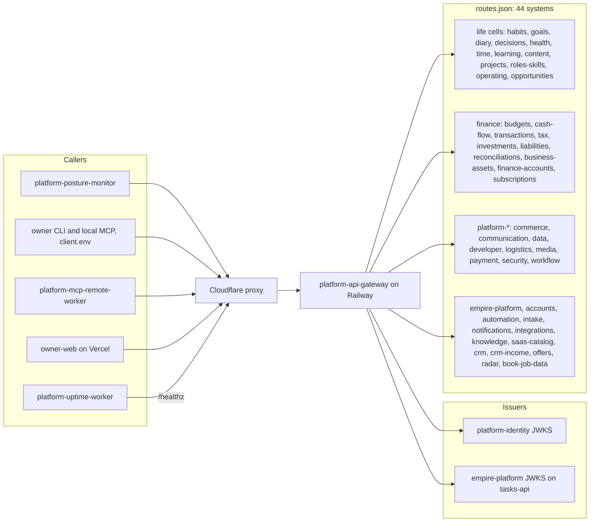

# 19 — Service dependency map (runtime)

Not routed (by design, `scripts/generate_routes.py` `SKIP_IDS`/`SKIP_KINDS`): `api-gateway` itself, `identity`, `ai-gateway`, web frontends
ไม่มี DB, cache, queue หรือ CDN อื่นนอกจาก Cloudflare

Sources: `routes.json`, `scripts/generate_routes.py`, `contract.json` (`depends_on: identity`, `migration.cutover`), `src/book_api_gateway/jwt_verify.py`, platform-uptime-worker `src/targets.ts`, platform-posture-monitor `posture_monitor/audit.py`, platform-mcp-remote-worker `src/worker.ts` (grep `gateway.bookchaowalit`), ops record: api-gateway-edge (2026-11-03)
