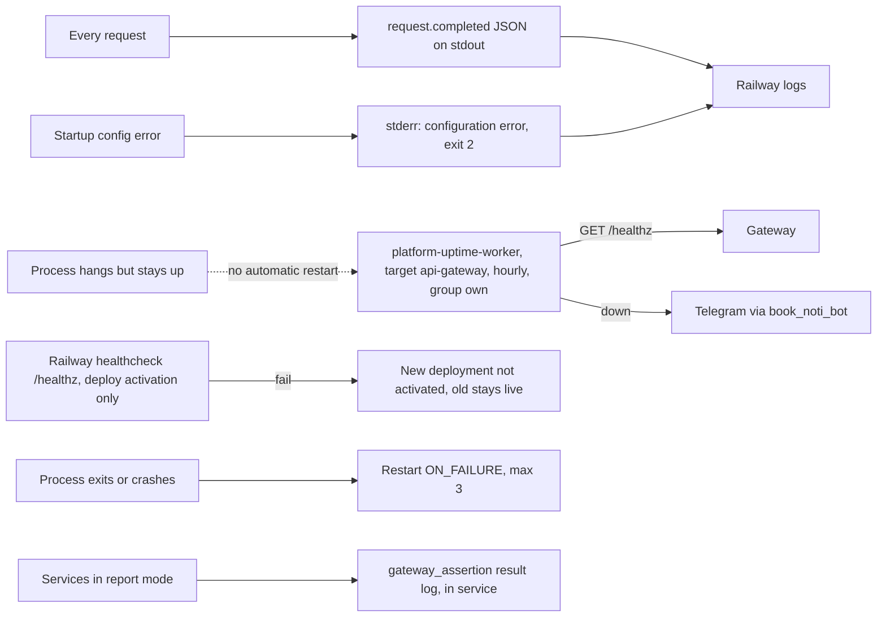

# 20 — Observability

| Signal | Content | Watched by |
|---|---|---|
| `request.completed` | method, route (`healthz`/`readyz`/`api`/`v1`/`other`), system, status, latency_ms, request_id, subject_hash | Railway logs, manual search (no alert) |
| `/healthz` | `status`, `auth_configured` | uptime worker hourly (sleeping set) + Railway healthcheck |
| `/readyz` | `upstream_reachable` = route table loaded (edge mode) | ไม่มีผู้เฝ้า |
| Sentry | **none** (waiver in PRODUCT.md) | — |
| PostHog / metrics / traces | none | — |
| SPEC-002 report log | `gateway_assertion result=valid, missing or invalid` | อยู่ใน service (habits) ไม่ใช่ repo นี้ |

Sources: `src/book_api_gateway/server.py` (`_default_telemetry`, `_handle_request`, `_route_class`, `main`), `railway.toml`, `PRODUCT.md` (Sentry waiver), platform-uptime-worker `src/targets.ts` (line 84-85), `docs/specs/002-gateway-assertion.md` R5, ops record: prod-baseline-monitoring-backups (2026-11-03) (Telegram via book_noti_bot), ops record: api-gateway-edge (2026-11-03)

## Open questions

- ไม่มี alert จากอัตรา 5xx/429 ใน logs — ต้องการ log-based alert หรือ dashboard หรือไม่
- ไม่มี heartbeat สำหรับ JWKS fetch failure (503 จะเห็นใน logs เท่านั้น)
