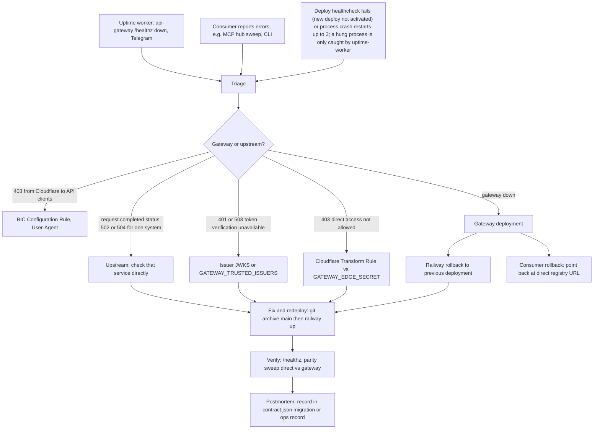

# 21 — Incident response

ไม่มี runbook ใน repo; flow นี้ประกอบจาก alert channel และ rollback ที่มีอยู่จริง

ตัวอย่างจริง (ops record 2026-11-03): Cloudflare BIC ตอบ 403 ให้ `Python-urllib` → แก้ด้วย Configuration Rule `bic: false`; MCP hub deploy ทำ `PUBLIC_ORIGIN` หาย → `/mcp` 503 แก้ภายในไม่กี่นาที (ฝั่ง worker ไม่ใช่ gateway)

Sources: platform-uptime-worker `src/targets.ts`, `.railway/railway.ts`, `src/book_api_gateway/edge.py` (error messages), `API.md`, `contract.json` (`migration.rollback`), Railway `list-deployments` (`canRollback`), ops record: api-gateway-edge (2026-11-03), ops record: prod-baseline-monitoring-backups (2026-11-03)

## Open questions

- ไม่มี postmortem template หรือที่เก็บ incident ของ gateway โดยเฉพาะ
- severity/SLA ของ gateway (เป็น single point ของ 4 กลุ่ม consumer) ยังไม่ได้กำหนด
