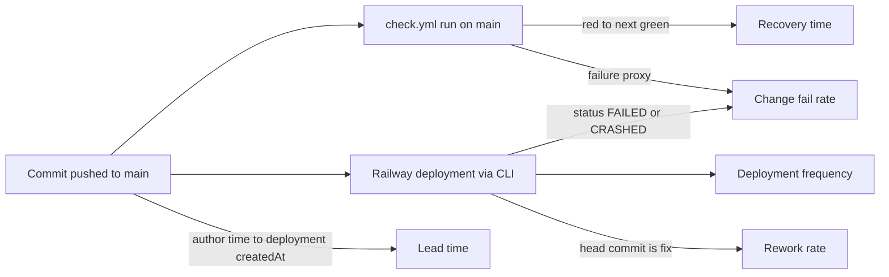

# 22 — DORA metrics

ช่วงวัด: 90 วัน **2026-08-05 → 2026-11-03** (วัดเมื่อ 2026-11-03 ~16:40 UTC)
**นิยาม deployment:** Railway deployment ของ project `platform-api-gateway` service `gateway` (CLI upload `railway up`); project ถูกสร้าง 2026-11-03 04:58 UTC จึงมี deployment เฉพาะวันนั้น — commit ก่อนหน้านั้น (pilot, 2026-09-17 → 10-22) ไม่เคย deploy

| Metric | How measured here | Value (90 days) | Command |
|---|---|---|---|
| Deployment frequency | Railway deployments of service `gateway` | **14 deployments, all on 2026-11-03** (1 active day); 13 REMOVED by a newer one, 1 SUCCESS live (`e2bd3ba7`, 16:21 UTC) | Railway MCP `list-deployments projectId=451cd409-… limit=50` (or `railway deployment list`) |
| Lead time for changes | commit author time → createdAt of the first deployment after it (pairing by time; Railway upload records no SHA) over 23 deployed commits | **median 0.1 min, p90 49.6 min, max 54.4 min** (`a168274`, contract note); 2 later commits (`e05aaaf`, `4c81817`, contract only) not yet deployed | `git log origin/main --since=2026-11-02 --format='%h %aI %s'` + the deployment list above |
| Change fail rate | (a) deployments with status FAILED/CRASHED; (b) proxy: `check.yml` push runs on `main` with `failure` | (a) **0 / 14 = 0 %**; (b) **7 / 36 = 19.4 %** (`b171738`, `8d19e7c`, `2bcd40d`, `e653535`, `8481507`, `e05aaaf`, `4c81817`) | `gh run list -R bookchaowalit-backend/platform-api-gateway --branch main --limit 100 --json conclusion,createdAt,headSha` |
| Failed deployment recovery time | production: no failed deployment → **not measurable**; CI proxy: red run on `main` → next green | CI: **2 h 01 min** (`b171738` 03:35 → `4506614` 05:36 UTC, 2026-10-13), **3 min** (`2bcd40d` 09:41 → `7943803` 09:44, 2026-10-22); **open** since `e653535` 16:17 UTC 2026-11-03 (Ruff on `scripts/assertion_key.py`) | same `gh run list`, ordered by `createdAt` |
| Deployment rework rate | deployments whose newest included commit subject starts with `fix` | **10 / 14 = 71 %** (`9ca3015`, `cd5d239`, `1d204d8`, `c998368`, `4117fec`, `f7b1edf`, `754413c`, `635f6ef`, `c7b16d1`, `8481507`); commit-level: 16 / 48 = 33 % `^fix` | `git log origin/main --since="90 days ago" --format='%s' \| grep -ciE '^(fix\|revert)'` |

Sources: `git log origin/main`, `gh run list -R bookchaowalit-backend/platform-api-gateway` (47 runs, 36 on `main`), Railway `list-deployments` project `platform-api-gateway` (2026-11-03), `.github/workflows/check.yml`, `.railway/railway.ts`

## Caveats

- ทั้ง 14 deployments อยู่ในวันเดียว (วัน go-live) จึงยังไม่สะท้อนจังหวะปกติ; rework rate สูงเพราะเป็นรอบ review fixes ของวันแรก (ops record: api-gateway-edge, review fixes `cd5d239` และต่อมา)
- deploy ไม่ได้รอ CI: deployment `e2bd3ba7` (16:21 UTC) เกิดหลัง CI ของ `e653535` แดงแล้ว — CI failure จึงไม่ใช่ deployment failure
- การจับคู่ commit ↔ deployment ใช้เวลา ไม่ใช่ SHA

## Open questions

- จะให้ deployment บันทึก SHA (เช่น Railway variable หรือ tag) เพื่อให้ lead time/rework วัดได้แน่นอนหรือไม่
- ควรนับ consumer cutover (เปลี่ยน env ของ consumer) เป็น deployment ของ gateway ด้วยหรือไม่
